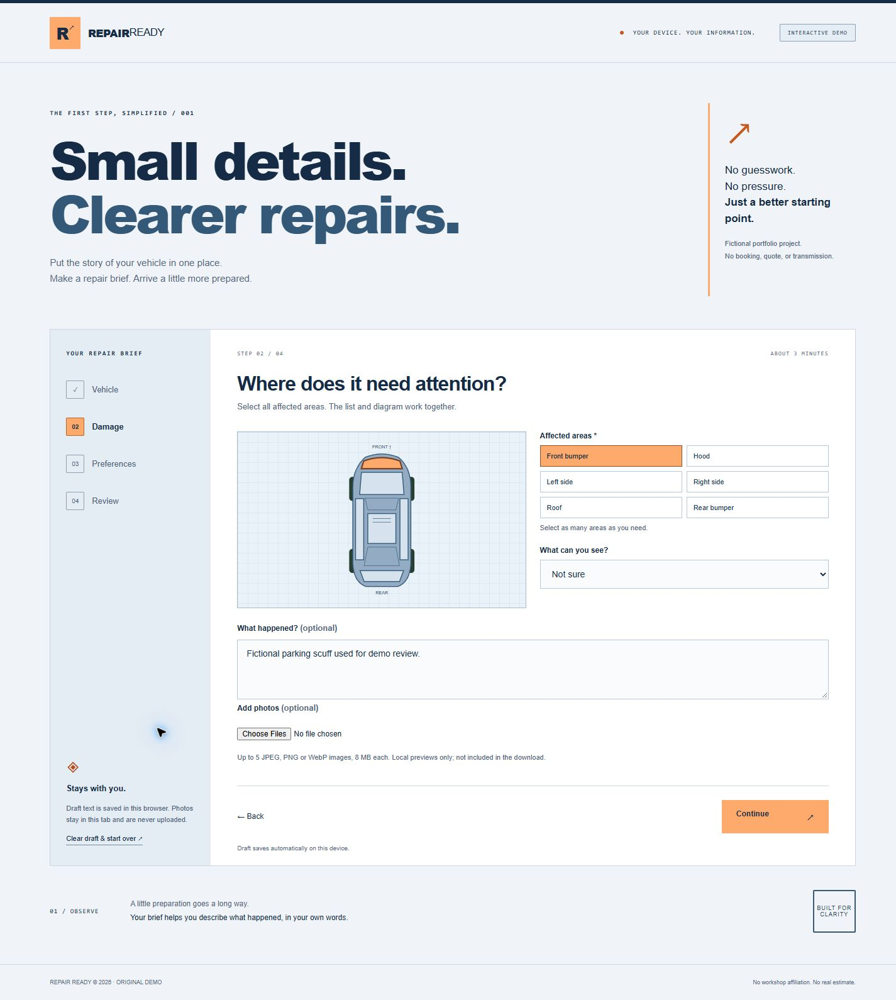
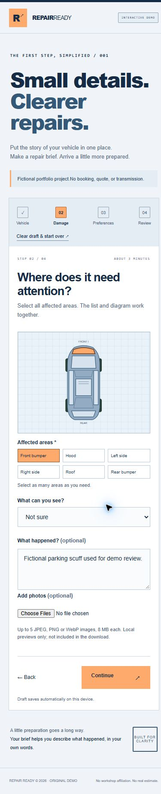

# Repair Ready

A considered first step for describing vehicle damage. Repair Ready is an original, browser-only intake demo with a technical navy-and-orange visual identity, blueprint-style SVG vehicle illustrations, and a four-step workflow.

**Demo only:** this project has no workshop affiliation and does not produce a quote, book an appointment, upload photos, or transmit information. There are no accounts, payments, analytics, or external APIs.




## Try it locally

Requires Node.js 20 or newer. There are no runtime or development dependencies; no installation is required.

```sh
node scripts/serve.mjs
```

Open `http://127.0.0.1:4173`. Set the `PORT` environment variable if needed. With npm available, `npm run dev` is equivalent.

```sh
node --test
node scripts/build.mjs
node scripts/serve.mjs --dist
```

The build copies the four application files into `dist/`, ready for any static host. Paths are relative, so the app also works under a repository subpath. `package-lock.json` records the intentionally empty dependency tree. No dependency audit is required for third-party packages because none are included; use a maintained Node release for local tooling.

## Working features

- Vehicle year, make, and model validation.
- Six selectable damage zones in an original top-view diagram, mirrored by keyboard-accessible toggle buttons.
- Severity, optional notes, and up to five local JPEG, PNG, or WebP previews with size/type checks and removal controls.
- Date, time-of-day, and waiting preferences with past-date validation.
- Editable review and a downloadable JSON brief, with explicit demo labels.
- Safe browser-local draft persistence. Malformed saved fields are normalized, and unavailable storage falls back to an in-memory session.
- Confirmed clear-draft action, responsive layouts, skip link, visible keyboard focus, status announcements, and reduced-motion support.

## Architecture

`index.html` contains the semantic shell. `styles.css` owns the responsive visual system. `app.js` manages the step state, DOM rendering, photo object URLs, local storage, and download lifecycle. `model.js` contains the pure validation, saved-data normalization, and export model shared with `test/model.test.js`.

The application uses native browser ES modules and Node built-ins. User-entered text is escaped before HTML rendering. Photos use temporary object URLs and are revoked when removed or reset. The local preview server binds to loopback only and rejects paths outside its root; it is development tooling, not a production server.

## Validation

The automated suite covers required vehicle fields, model-year bounds, required damage selection, saved-data normalization, invalid/past date preferences, and the demo-only export contract. Run `node --test` to reproduce. The static build is checked with `node scripts/build.mjs`.

Actual rendered desktop and phone screenshots are kept in `screenshots/`. These show the app rather than design mockups.

## Limitations and privacy

Draft text persists in this browser until cleared. Anyone using the same browser profile can access it. Avoid entering sensitive or identifying information. Photos are not persisted across reloads and are not embedded in the downloaded brief. Dates describe preferences only, using the device's current date. There is no repair-price logic, availability lookup, diagnosis, or delivery service. Users must contact a workshop themselves.

All UI copy, illustrations, and demo interactions were created for this fictional portfolio project. System fonts require no downloads. No open-source license has been selected; the repository intentionally contains no LICENSE file.


Detailed executed checks and verification limits: [QA record](QA.md).
